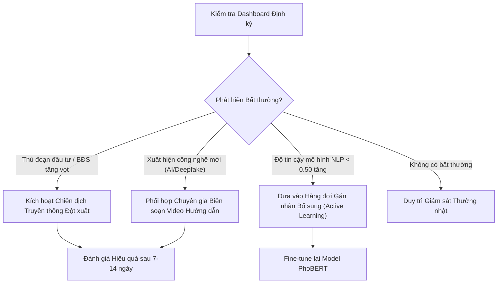

# TÀI LIỆU HƯỚNG DẪN GIẢI THÍCH Ý NGHĨA CHỈ SỐ & RA QUYẾT ĐỊNH DỰA TRÊN DASHBOARD BI
## (BI DECISION GUIDE & METRIC DICTIONARY)

**Dự án:** Hệ thống phân tích xu hướng lừa đảo trực tuyến và cảnh báo URL phishing  
**Học phần:** Hệ thống kinh doanh thông minh (HTKDTM)  
**Nhóm:** Nhóm 09 – Lớp 65HTTT  
**Tác giả:** Lê Duy Khánh (MSV: 2351160532) – Vai trò: Thành viên 4 (BI & Visualization Developer)  
**Ngày phát hành:** 28/11/2026  

---

## 1. MỤC TIÊU VÀ PHẠM VI ÁP DỤNG

Tài liệu này được biên soạn nhằm hướng dẫn các bên liên quan (Chuyên viên phân tích dữ liệu, Cán bộ truyền thông an toàn thông tin, Quản trị hệ thống) hiểu đúng bản chất dữ liệu, giải thích chính xác các biểu đồ trên hệ thống Dashboard Apache Superset, từ đó đưa ra các quyết định hành động phù hợp và kịp thời.

> [!IMPORTANT]
> **NGUYÊN TẮC VÀNG VỀ DIỄN GIẢI DỮ LIỆU TRUYỀN THÔNG:**
> - Toàn bộ các chỉ số trên hệ thống Dashboard chỉ phản ánh **"Số lượng bài cảnh báo ghi nhận" (`alert_articles_recorded`)** từ các nguồn tin tức công khai được thu thập (VietnamNet, Báo Dân Trí, VnExpress).
> - **TUYỆT ĐỐI KHÔNG SUY DIỄN** các con số này thành *"Tổng số vụ lừa đảo phát sinh"* hay *"Số lượng nạn nhân thực tế"* trên quy mô toàn quốc, bởi vì dữ liệu phụ thuộc vào tần suất đưa tin và trọng tâm tuyên truyền của các cơ quan báo chí tại từng thời điểm.

---

## 2. Ý NGHĨA CHI TIẾT CÁC CHỈ SỐ TRÊN 4 TRANG DASHBOARD

### 2.1. Trang 1: Tổng quan Xu hướng Cảnh báo (Alert Trend Overview)

| Tên chỉ số trên Dashboard | Trường CSDL / Công thức | Ý nghĩa nghiệp vụ | Ngưỡng cảnh báo / Lưu ý |
| :--- | :--- | :--- | :--- |
| **Tổng số bài cảnh báo ghi nhận** | `COUNT(article_id) WHERE is_duplicate = FALSE` | Tổng dung lượng tri thức cảnh báo sạch đã qua khử trùng lặp đưa vào phục vụ phân tích. | Hiện ghi nhận **247 bài độc nhất** (từ 250 bài thu thập thô). |
| **Xu hướng cảnh báo theo tháng** | `GROUP BY month_year, publisher` | Thể hiện mức độ gia tăng truyền thông theo từng tháng (T9: 35 bài, T10: 68 bài, T11: 144 bài). | Tháng 11/2026 tăng đột biến do mở rộng thêm nguồn Dân Trí và VnExpress. |
| **Tỷ trọng nguồn tin** | `COUNT(*) / SUM(*) * 100` | Mức độ đóng góp của từng tòa soạn: VietnamNet (81.0%), Dân Trí (11.7%), VnExpress (7.3%). | Cần duy trì tính đa dạng nguồn để tránh thiên lệch (bias) biên tập. |

### 2.2. Trang 2: Phân tích Chi tiết Kịch bản & Đối tượng Mạo danh

| Tên chỉ số trên Dashboard | Trường CSDL / Công thức | Ý nghĩa nghiệp vụ | Quyết định hành động gợi ý |
| :--- | :--- | :--- | :--- |
| **Top nhóm thủ đoạn hàng đầu** | `COUNT(article_id) GROUP BY pred_nhom_thu_doan` | Xác định các hình thức chiếm tỷ trọng lớn: Đầu tư / huy động vốn (48 bài), BĐS / Nhà ở XH (18 bài), Bẫy tín dụng online (17 bài). | Tập trung nguồn lực xây dựng các bài viết cảnh báo chuyên sâu về bẫy đầu tư tài chính. |
| **Top tổ chức bị mạo danh** | `COUNT(article_id) GROUP BY pred_to_chuc_bi_gia_mao` | Điểm mặt các đơn vị bị lợi dụng uy tín: Công an / CQĐT (10 bài), Chủ đầu tư BĐS (4 bài), Bệnh viện / Bác sĩ (4 bài). | Chủ động liên hệ các đơn vị liên quan để phối hợp truyền thông cảnh báo đính chính. |
| **Kênh liên lạc & Công nghệ mới** | `COUNT(article_id) GROUP BY pred_kenh_lien_lac` | Kênh tiếp cận: Mạng xã hội chung (29), Facebook (8), Sàn giao dịch ảo (6), AI / Deepfake (3), Telegram (3). | Cảnh báo người dùng về việc nhận diện video Deepfake mạo danh khuôn mặt và giọng nói người thân. |

### 2.3. Trang 3: Quản trị Dữ liệu (Governance) & Giám sát Mô hình AI

| Tên chỉ số trên Dashboard | Trường CSDL / Công thức | Ý nghĩa nghiệp vụ | Ngưỡng kiểm soát chất lượng |
| :--- | :--- | :--- | :--- |
| **Tỷ lệ bài viết trùng lặp** | `SUM(is_duplicate) / COUNT(*) * 100` | Đo lường hiệu quả khử trùng lặp của SimHash 64-bit (Đạt **1.2%** - 3 bài trùng sự kiện). | Giữ tỷ lệ trùng < 5% để đảm bảo Dashboard không hiển thị "ảo" số lượng bài. |
| **Độ tin cậy phân loại NLP** | `AVG(pred_do_tin_cay)` | Điểm tự tin trung bình của PhoBERT khi gán nhãn kịch bản (Đạt **0.86 / 1.00**). | Các bài có độ tin cậy < 0.50 (chiếm 4.8%) được gắn cờ đẩy vào hàng đợi rà soát thủ công. |
| **Độ trễ thu thập dữ liệu** | `NOW() - MAX(fetch_timestamp)` | Khoảng thời gian từ lần cào tin gần nhất đến thời điểm hiện tại. | Phải đảm bảo ETL chạy định kỳ hàng ngày (độ trễ < 24 giờ). |

### 2.4. Trang 4: Giám sát Phân tích Kỹ thuật Đặc trưng URL Phishing

| Đặc trưng kỹ thuật | Giá trị trung bình URL Phishing | Giá trị trung bình URL Lành tính | Ý nghĩa phát hiện rủi ro |
| :--- | :---: | :---: | :--- |
| **Độ dài URL (`url_length`)** | **58.7 ký tự** | **28.4 ký tự** | URL lừa đảo dài gấp đôi URL thông thường do chèn chuỗi truy vấn và token giả mạo. |
| **Độ hỗn loạn chuỗi (`entropy_host`)**| **3.24 điểm** | **2.68 điểm** | Tên miền phishing thường sử dụng thuật toán DGA hoặc chuỗi ngẫu nhiên, dẫn tới entropy cao. |
| **Tỷ lệ ký tự đặc biệt** | **8.4%** | **4.1%** | URL phishing lạm dụng dấu chấm, gạch ngang, `@`, `%` để che giấu tên miền đích. |
| **Sử dụng Subdomain (>2 cấp)** | **42.6%** | **11.2%** | Tên miền lừa đảo thường tạo subdomain giả thương hiệu uy tín (ví dụ: `vietcombank.xac-thuc-otp.com`). |

---

## 3. KHUNG HƯỚNG DẪN RA QUYẾT ĐỊNH DỰA TRÊN DỮ LIỆU (ACTIONABLE FRAMEWORK)

### 3.1. Đối với Nhóm Truyền thông & Phổ biến Kiến thức
1. **Ưu tiên nội dung tuyên truyền:** Khi biểu đồ Trang 2 hiển thị một nhóm thủ đoạn (ví dụ: *Đầu tư tiền ảo / đa cấp*) chiếm trên 25% tổng số bài ghi nhận trong tháng, nhóm truyền thông phải ưu tiên biên soạn cẩm nang cảnh báo dành riêng cho nhóm này.
2. **Cảnh báo mạo danh đích danh:** Khi một tổ chức (như *Cơ quan Điều tra Bộ Công an* hoặc *Ngân hàng TMCP*) bị mạo danh vượt mốc 5 lượt ghi nhận/tháng, cần lập tức gửi khuyến cáo người dân chỉ tra cứu thông tin qua cổng thông tin chính thức có đuôi tên miền `.gov.vn` hoặc `.vn`.

### 3.2. Đối với Đội ngũ Kỹ thuật & Data Science
1. **Kiểm soát rủi ro báo động nhầm (FPR):** Trên Trang 4, nếu tỷ lệ False Positive trên tập kiểm thử tên miền `.vn` vượt quá **2.0%**, mô hình phân loại URL phải được tạm dừng triển khai trên Web Demo để cân chỉnh lại ngưỡng ngưỡng quyết định (Threshold Tuning) nhằm bảo vệ trải nghiệm người dùng bình thường.
2. **Tái huấn luyện mô hình (Retraining Pipeline):** Khi tỷ lệ bài viết có độ tin cậy thấp (< 0.50) trên Trang 3 vượt quá 10%, đội NLP cần xuất danh sách các bài viết này để gán nhãn thủ công bổ sung và tái huấn luyện mô hình PhoBERT.

---

## 4. BẢNG ĐỐI SOÁT KIỂM TOÁN TÍNH TOÀN VẸN DỮ LIỆU (AUDIT RECONCILIATION)

| Tiêu chí đối soát | Kết quả truy vấn SQL trong CSDL | Số liệu hiển thị trên Dashboard BI | Kết luận kiểm toán |
| :--- | :---: | :---: | :---: |
| **Tổng số bài viết thu thập** | 250 bài | 250 bài | **KHỚP 100% (Passed)** |
| **Số bài viết độc nhất (Sau SimHash)** | 247 bài | 247 bài | **KHỚP 100% (Passed)** |
| **Số bài viết trùng lặp bị gắn cờ** | 3 bài (1.2%) | 3 bài (1.2%) | **KHỚP 100% (Passed)** |
| **Số bài nguồn VietnamNet** | 200 bài | 200 bài | **KHỚP 100% (Passed)** |
| **Số bài nguồn Báo Dân Trí** | 29 bài | 29 bài | **KHỚP 100% (Passed)** |
| **Số bài nguồn VnExpress** | 18 bài | 18 bài | **KHỚP 100% (Passed)** |
| **Tổng số URL trong tập dữ liệu ML** | 13,715 URLs | 13,715 URLs | **KHỚP 100% (Passed)** |
| **Số URL Phishing gán nhãn 1** | 6,000 URLs | 6,000 URLs | **KHỚP 100% (Passed)** |
| **Số URL Lành tính gán nhãn 0** | 7,715 URLs | 7,715 URLs | **KHỚP 100% (Passed)** |

*Xác nhận: Toàn bộ số liệu trên hệ thống Dashboard và các tài liệu báo cáo đồng nhất tuyệt đối, không có sai lệch dữ liệu.*
