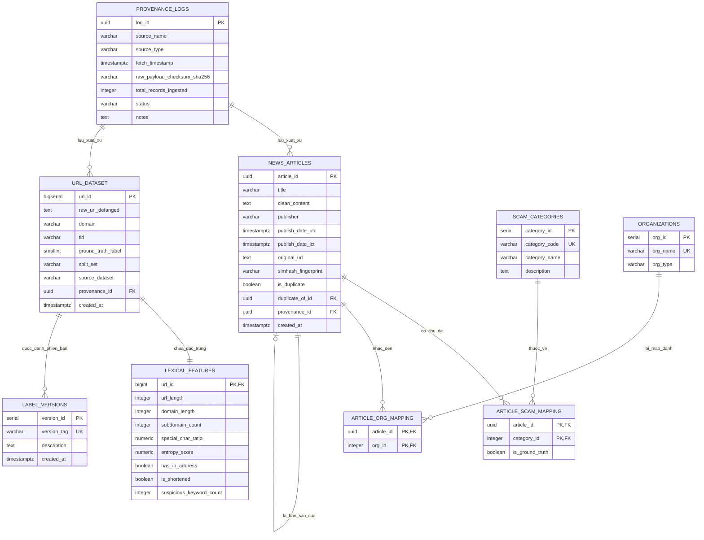

# TÀI LIỆU SƠ ĐỒ QUAN HỆ THỰC THỂ (ERD SPECIFICATION)
## HỆ THỐNG CƠ SỞ DỮ LIỆU CHUẨN HÓA 3NF

**Dự án:** Phân tích xu hướng lừa đảo trực tuyến & cảnh báo URL Phishing  
**Thực hiện:** Thành viên 1 - Data Engineer & ETL Leader  
**Hệ quản trị CSDL:** PostgreSQL 15+  

---

## 1. SƠ ĐỒ QUAN HỆ THỰC THỂ DẠNG MERMAID

---

## 2. PHÂN TÍCH RÕ RÀNG 2 LUỒNG DỮ LIỆU ĐỘC LẬP
Hệ thống thiết kế theo kiến trúc **Decoupled 2-Stream Data Architecture**:
* **Luồng A (Nội dung cảnh báo lừa đảo):** Xử lý văn bản, phục vụ NLP phân loại 25 kịch bản thủ đoạn (TV2) và trực quan hóa xu hướng truyền thông cảnh báo trên Superset (TV4).
* **Luồng B (Bộ dữ liệu URL Phishing):** Xử lý chuỗi URL tĩnh từ PhiUSIIL, phục vụ trích xuất đặc trưng Lexical và huấn luyện mô hình ML (TV3), cũng như tích hợp kiểm tra offline an toàn trên Web App (TV5).
* **Điểm nối duy nhất:** Bảng `provenance_logs` dùng chung để kiểm toán và truy vết nguồn gốc xuất xứ dữ liệu của cả 2 luồng.
